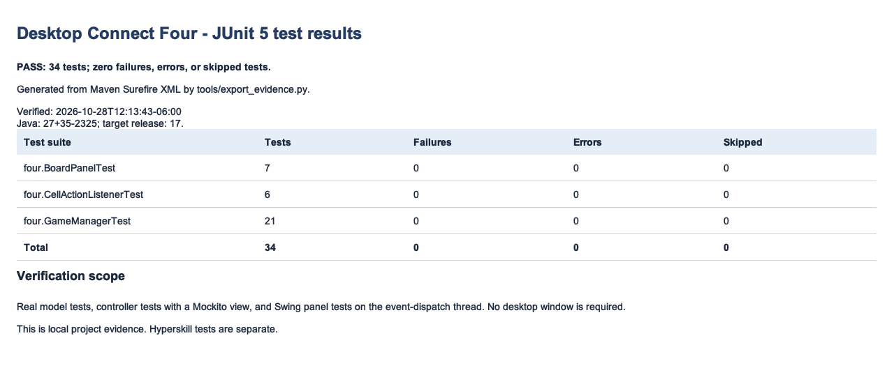
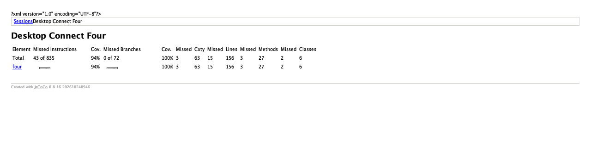
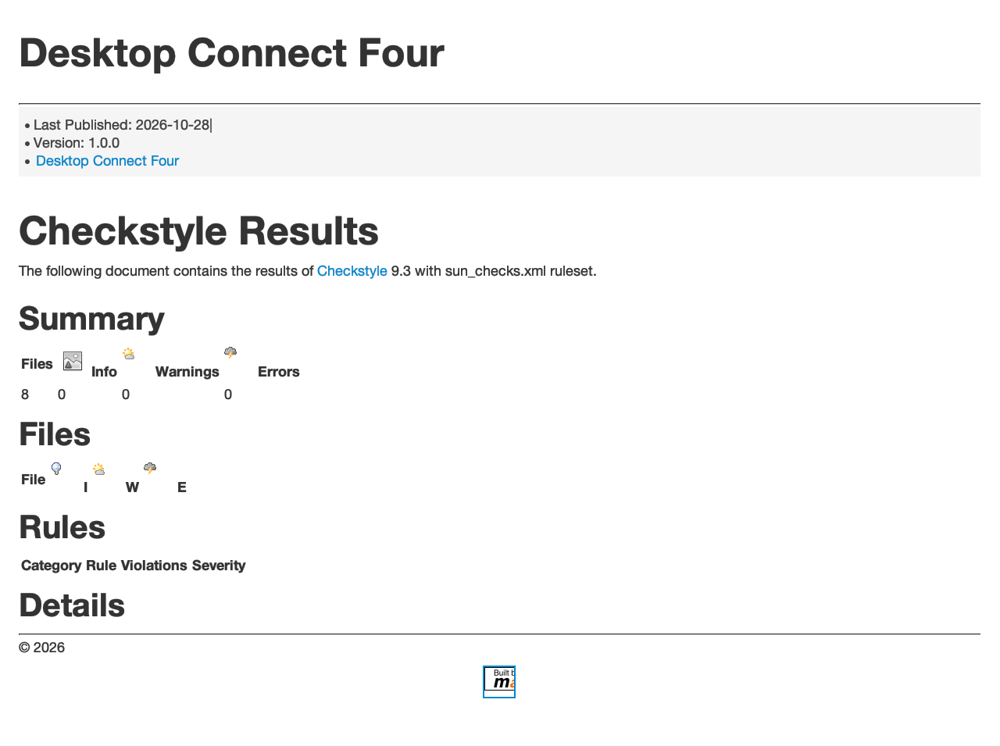
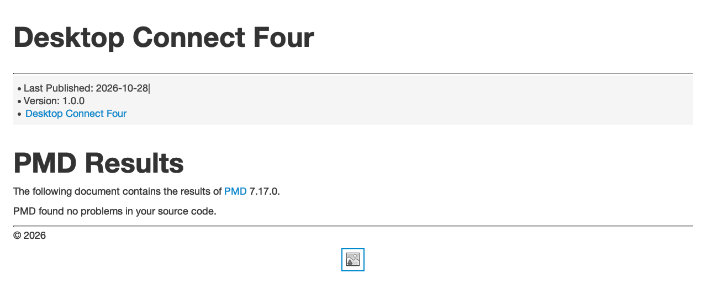
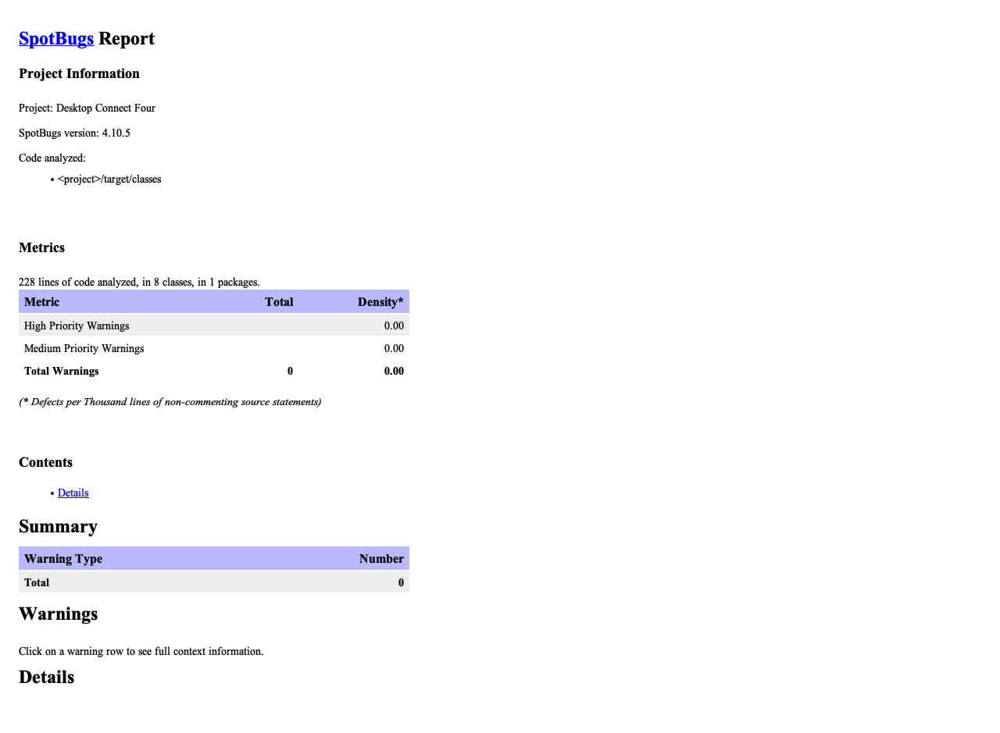

# Verification evidence

Recorded on **2026-10-28** with **OpenJDK 27**, **Maven Wrapper 3.9.16**, and
Java release **17** on macOS ARM64. The complete `clean verify` lifecycle
finished successfully using a local dependency cache in offline mode.

| Check | Result |
| --- | --- |
| JUnit | 34 tests passed; no failures, errors, or skipped tests. |
| JaCoCo lines | 141 covered / 156 total = **90.38%**. |
| JaCoCo branches | 72 covered / 72 total = **100%**. |
| Checkstyle | 8 source files; 0 violations with `sun_checks.xml`. |
| PMD | 0 configured-rule violations or processing errors. |
| SpotBugs + Find Security Bugs | 8 classes analyzed; 0 bugs, errors, or missing classes. |
| Javadoc | Private-member documentation passed `-Xdoclint:all`. |

## Provenance and scope

- [Successful Maven log](verify.log), with machine-specific paths normalized.
- [Javadoc log](javadoc.log).
- [Machine-readable summary](summary.json).
- [SHA-256 manifest of the verified build inputs](source-sha256.txt).
- [Individual JUnit case names and suite totals](data/tests.json).
- [Checkstyle XML](data/checkstyle.xml), [PMD XML](data/pmd.xml), and
  [SpotBugs XML](data/spotbugs.xml).
- [JaCoCo XML counters](reports/jacoco/jacoco.xml).

The five PNGs below are **off-screen renders of report HTML**, created with
`tools/ReportCapture.java`. The available browser could not start in this
execution environment. Swing's HTML renderer has limited CSS support, so
the appearance differs from a browser; the underlying HTML snapshots are
also included. The JUnit summary is generated from actual Surefire XML by
`tools/export_evidence.py`, not by the Surefire HTML report plugin.

This evidence does not claim a Hyperskill platform run, a GitHub Actions run,
or an interactive JFrame smoke test. Those were not executed in this session.

## JUnit results

[HTML summary](reports/tests.html)

## JaCoCo coverage

[Original HTML report](reports/jacoco/index.html)

The first `Cov.` column in JaCoCo is **instruction coverage**, rounded to 94%.
The line coverage required by the internship is calculated from the LINE
counter: 141 / 156 = 90.38%. Branch coverage is 100%. No production classes
are excluded; the headless suite leaves the JFrame and entry-point code
uncovered, and those lines remain in the total.

## Checkstyle

[Original HTML report](reports/maven/checkstyle.html)

## PMD

[Original HTML report](reports/maven/pmd.html)

## SpotBugs and Find Security Bugs

[HTML report](reports/spotbugs.html)

The quality gate's XML is retained separately from the HTML reporter's XML
output. This preserves complete analyzed-class metrics for the gate report.
Find Security Bugs is enabled in the Maven plugin configuration and recorded
as an enabled plugin in the exported XML.

